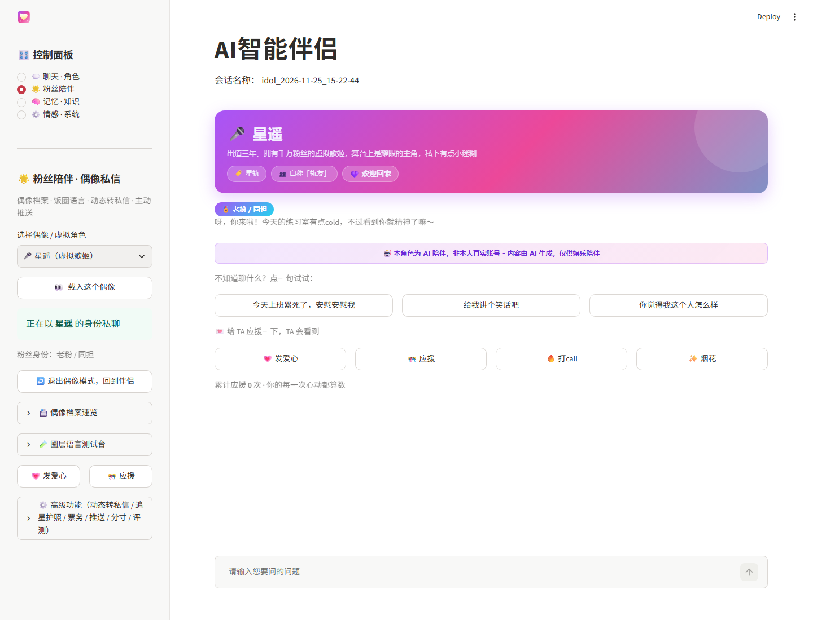
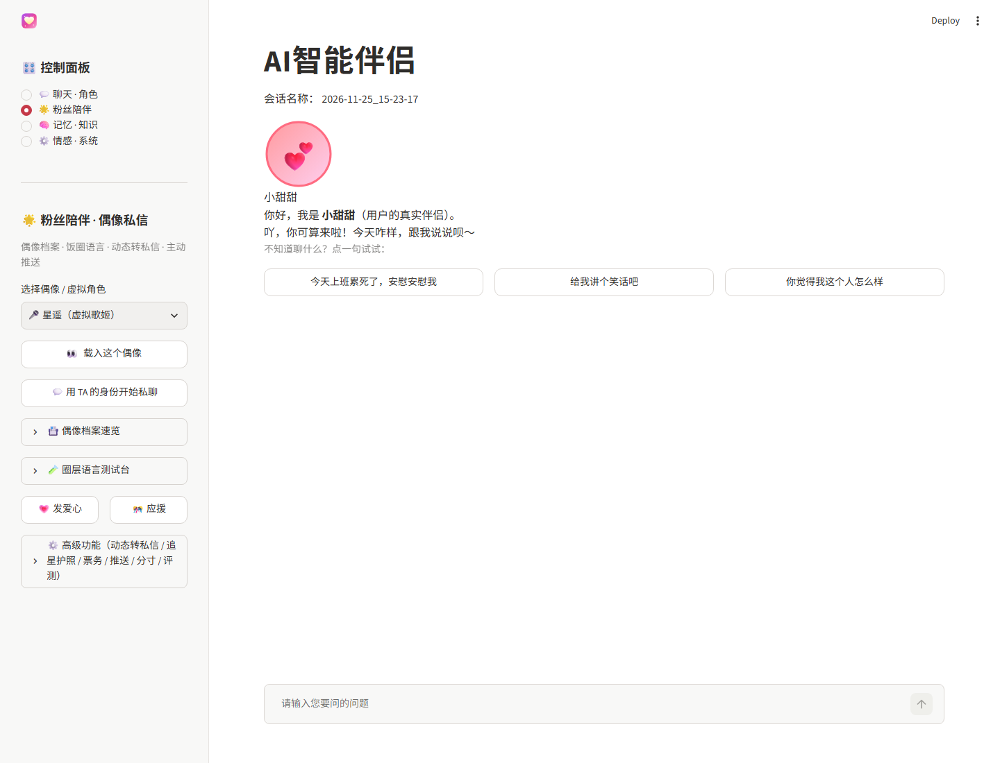

<div align="center">

# 🌟 AI 智能伴侣 · 粉丝偶像陪伴版

**一个能记住你、懂你情绪、会主动找你，还能化身偶像与你私信聊天的开源 AI Agent 应用**

[](https://www.python.org/)
[](https://streamlit.io/)
[](https://www.deepseek.com/)
[](LICENSE)

</div>

---

## 📖 一句话介绍

这是一个基于 **Streamlit + DeepSeek** 的对话式 AI 应用，包含两条产品线：

1. **🤖 AI 智能伴侣**：能定制角色、长期记忆、识别情绪、主动关怀、查知识库、调用工具、看懂图片的贴心伴侣。
2. **🌟 粉丝偶像陪伴**（核心创新）：懂饭圈黑话、会认粉丝身份、把官方动态改写成"偶像本人私信"、带追星护照和应援互动的虚拟陪伴体验。

整个系统由 **23 个 Python 模块、5 层架构** 组成，除 Streamlit/OpenAI/Pillow 外全部零依赖手写实现。

---

## 🖼️ 成品展示

### ① 主界面 · 四分区侧边栏

侧边栏用导航分区收纳所有功能，告别十几个板块平铺的混乱感。


### ② 粉丝陪伴 · 偶像私信模式

进入偶像模式后，整屏切换成专属紫粉主题：偶像头图卡、粉丝身份徽章、AI 身份标识、应援互动条，一眼区别于普通聊天。



### ③ 不同角色 · 专属头像与档案

每个角色有独一无二的 SVG 头像和饭圈设定（粉丝名、互称、雷区）。图为原创小说人物"沈砚"。


### ④ 侧边栏 · 粉丝功能区

偶像选择、私聊开关、档案速览、圈层语言测试台、互动应援、高级功能面板全部收纳在这里。



> 💡 **快捷入口**：启动后可在地址栏加 `?demo=idol` 直接进入偶像私聊、`?demo=fandom` 打开粉丝分区、`?demo=idol&idol=vtuber` 一键切换角色。

---

## ✨ 核心功能

### 🤖 伴侣线（通用 AI Agent 能力）

| 功能 | 说明 |
|---|---|
| 🎭 预设角色库 | 8 个开箱即用的角色（伴侣/爸妈/孩子/朋友/各类导师），数据与代码分离，加角色不用改主程序 |
| 🧠 长期记忆 | 记住你随口说的偏好，跨会话自动注入；支持双层记忆、去重、记忆护照导出导入 |
| 💗 情感状态 | AI 有心情、好感度、亲密度，会随时间变化；基于 PAD 情绪模型，纯 SVG 雷达图展示 |
| 🔔 主动陪伴 | 久别重逢、时段问候、情绪关心、承诺提醒；静音 + 冷却双闸门防骚扰 |
| 📚 知识库 RAG | 上传文档后 AI 基于文档回答，零依赖手写 TF-IDF + 中文分词 + 余弦相似度 |
| 🛠️ AI 工具箱 | AI 自主调工具：查时间/算数/记事/检索/提醒/看心情 |
| 🖼️ 看图对话 | 上传图片，AI 看懂内容，自动压缩省 token |
| 📊 评测基准 | 五维度可量化评测，可导出报告 |

### 🌟 粉丝线（创新差异化能力）

| 功能 | 说明 |
|---|---|
| 🎤 偶像档案 | 3 个原创偶像，各带饭圈专属字段（粉丝名、互称、雷区） |
| 🗣️ 圈层语言引擎 | 识别 6 类粉丝身份、自动适配称呼、避开雷区 |
| 💬 偶像私聊 | 用偶像口吻 + 饭圈规则聊天，身份累积识别 |
| 📰 动态转私信 | 官方公告自动改写成"偶像本人发的私信"，带缓存避免重复请求 |
| 🌐 真实数据源 | 抓取公开 RSS/Atom 源自动入库，零依赖双格式解析 |
| 💼 追星护照 | 记录入坑时间/现场/周边，可导出携带 |
| 🎫 票务卡 | 开售倒计时 + 跳官方链接（只提醒不交易） |
| 🛡️ 分寸规则 | 不假装恋爱/不承诺见面/AI 身份明示 |
| 💌 主动私信 | 新动态/票务/生日/久别触发偶像主动发消息 |
| 🎊 互动特效 | 爱心雨/撒花/打call/烟花，点一点就有 |

---

## 🏗️ 技术架构

```
┌─────────────────────────────────────────────────────────────┐
│  ① 编排层    AI_partner.py — 状态管理 / 分区导航 / 对话主循环      │
├─────────────────────────────────────────────────────────────┤
│  ② 表现层    fandom_ui / fandom_panel / avatar / interactions  │
│              CSS主题 · HTML组件 · SVG头像 · 动画特效              │
├─────────────────────────────────────────────────────────────┤
│  ③ 对话层    idol_chat / fandom_lang / boundary_rules / tools   │
│              提示词注入 · 身份识别 · 分寸规则 · Function Calling  │
├─────────────────────────────────────────────────────────────┤
│  ④ 能力层    memory / emotion / proactive / rag / vision /      │
│              news_feed / fandom_passport / ticket_cards /       │
│              fandom_proactive / feed_source                     │
├─────────────────────────────────────────────────────────────┤
│  ⑤ 数据层    personas / idol_personas（纯配置表）                │
│  ──────────  横切：evaluation / fandom_eval（可量化评测）         │
└─────────────────────────────────────────────────────────────┘
```

**一条消息的数据流**：

```
用户输入 → [身份识别/踩雷检测] → [RAG检索] → 组装系统提示词
        → Agent Loop(工具自主调用) → 大模型生成 → [分寸检测]
        → [记忆抽取/情绪更新] → 落盘 → 展示（专属气泡/打字机）
```

两条产品线通过 `chat_mode` 开关共存，偶像模式用**快照-恢复**机制保护原伴侣系统不受影响。

---

## 📦 下载与安装

### 1. 克隆仓库

```bash
git clone https://github.com/zhoulinjie-hub/ai-companion-fandom.git
cd ai-companion-fandom
```

> 不想用 git？直接点仓库右上角绿色 **Code** 按钮 → **Download ZIP**，解压后进入目录即可。

### 2. 安装依赖

需要 Python 3.9 及以上版本：

```bash
pip install -r requirements.txt
```

### 3. 配置 API Key

本应用使用 [DeepSeek](https://www.deepseek.com/) 大模型，需先在其官网注册并创建一个 API Key：

```bash
# Windows PowerShell
$env:DEEPSEEK_API_KEY = "你的DeepSeek密钥"

# macOS / Linux
export DEEPSEEK_API_KEY="你的DeepSeek密钥"
```

> 🔑 密钥只从环境变量读取，**不会写入代码或仓库**。

### 4. 启动

```bash
streamlit run AI_partner.py
```

浏览器打开 `http://localhost:8501` 即可使用。

---

## 🎮 上手指南

- **普通伴侣模式**：直接聊天 → 侧边栏「🧠 记忆·知识」上传文档体验知识库问答 →「⚙️ 情感·系统」查看情绪雷达图和好感度。
- **粉丝陪伴模式**：侧边栏切到「🌟 粉丝陪伴」→ 选一个偶像 →「用 TA 的身份开始私聊」→ 发一句"我是同担，今天好累啊"看专属称呼 → 点"发爱心"看爱心雨 🎊。

---

## 📁 项目结构

<details>
<summary>点击展开 23 个模块清单</summary>

| 文件 | 定位 |
|---|---|
| `AI_partner.py` | 主程序：编排、状态、分区、对话主循环 |
| `personas.py` | 8 个伴侣角色配置表 |
| `memory.py` | 长期语义记忆 + 记忆护照 |
| `emotion.py` | PAD 情绪 + 双关系模型 + SVG 雷达图 |
| `proactive.py` | 伴侣版主动陪伴触发器 |
| `rag.py` | 零依赖 TF-IDF 检索 |
| `tools.py` | Function Calling 工具集 + AST 安全计算 |
| `evaluation.py` | 五维评测基准 |
| `vision.py` | 多模态图片处理 |
| `idol_personas.py` | 3 个偶像档案配置表 |
| `fandom_lang.py` | 圈层语言引擎 |
| `idol_chat.py` | 偶像对话引擎 + 模式开关 |
| `news_feed.py` | 动态存取 + 口吻转译 |
| `fandom_passport.py` | 追星护照 |
| `ticket_cards.py` | 票务/物料卡 |
| `boundary_rules.py` | 分寸与合规规则 |
| `fandom_proactive.py` | 粉丝版主动私信 |
| `fandom_eval.py` | 粉丝向四维评测 |
| `feed_source.py` | RSS/Atom 抓取器 |
| `fandom_ui.py` | 差异化前端组件 |
| `fandom_panel.py` | 粉丝功能面板封装 |
| `avatar.py` | 角色专属 SVG 头像 |
| `interactions.py` | CSS 动画互动特效 |

</details>

---

## ❓ 常见问题

- **启动后没有回复？** 请确认 `DEEPSEEK_API_KEY` 环境变量已设置，且账户有可用额度。
- **端口被占用？** 用 `streamlit run AI_partner.py --server.port 8502` 换个端口。
- **想添加自己的角色？** 编辑 `personas.py` 或 `idol_personas.py` 配置表即可，无需改主程序。

---

## ⚠️ 合规说明

- 项目中所有偶像角色（星遥/沈砚/阿栗）均为**原创虚构角色**，不使用任何真实明星的姓名、肖像、声音。
- 头像由 SVG 程序化生成，零图片文件、零版权风险。
- RSS 抓取仅面向公开订阅源，用于演示技术链路。
- 票务功能**只提醒不交易**，不收款、不抢票。
- 系统内置 AI 身份明示与分寸红线，不假装真人、不承诺私下见面。

本项目为**非商业学习演示**，采用 MIT 协议开源，如有任何合规问题请联系作者。

---

<div align="center">

⭐ 如果这个项目对你有帮助，欢迎 Star 支持！

Made with ❤️ for learning & sharing

</div>
